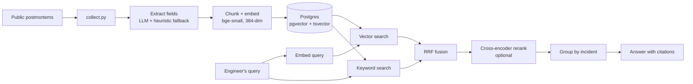

<p align="center"></p>

<p align="center">
  
  
  
  
  
</p>

# OutageLens

During an incident, the most useful question is "has anyone seen this before?" Big
companies publish hundreds of public postmortems, but nobody can read them all at 3 a.m.

**OutageLens** takes a plain-language description of a failure, finds similar past
incidents, and shows how those teams detected and fixed the cause, with links to the
original reports.

> "p99 latency tripled ten minutes after a deploy and the DB connection pool is full"
> returns incidents where a release removed a cache layer, with the root cause, how it
> was detected, and how it was rolled back.

## What makes it more than a chatbot

- **Structured extraction.** Every report is read once at ingestion and turned into
  filterable fields: category, root cause, detection, mitigation, prevention, impact.
- **Hybrid retrieval.** pgvector semantic search plus Postgres full-text, merged with
  Reciprocal Rank Fusion, optionally reordered by a cross-encoder.
- **Measured, not guessed.** `make eval` compares four retrieval strategies on a
  hand-labelled query set; `make bench` load tests the API. See [docs/evaluation.md](docs/evaluation.md).
- **Latency you can see.** Every response includes a per-stage timing breakdown, shown
  as a ribbon in the UI.
- **Works without an LLM.** With `LLM_PROVIDER=none`, answers are assembled from the
  extracted fields. Ollama or Anthropic can be switched on with one env variable.

## Architecture



## Quick start

```bash
cp .env.example .env
make up                      # Postgres + API on http://localhost:8000
make demo                    # loads 6 synthetic incidents to try the UI
```

For real data:

```bash
cp data/sources.example.csv data/sources.csv   # add 100+ postmortem URLs
make collect && make ingest
```

Run the unit tests (no database needed): `pip install -r requirements.txt && make test`

## API

| Method | Path | Purpose |
|---|---|---|
| POST | `/api/search` | Ranked incidents. Options: `mode` (vector, keyword, hybrid), `rerank`, `category`, `company`, `year_from`, `top_k` |
| POST | `/api/ask` | Hybrid search + rerank, then a cited answer |
| GET | `/api/meta` | Categories and companies with counts |
| GET | `/api/stats` | Index size and active models |
| GET | `/health` | Database check |

Interactive docs: `/docs`.

## Design decisions

| Decision | Why | Trade-off |
|---|---|---|
| RRF fusion, not a weighted sum | Scores from the two retrievers are on different scales; ranks are not | Ignores how much better rank 1 is than rank 2 |
| Postgres full-text, not a separate BM25 service | One datastore, simple deploy | `ts_rank_cd` is not BM25 |
| Per-incident results | Engineers want incidents, not fragments | Needs a grouping step after ranking |
| Heuristic fallback for extraction | Ingestion never fails on bad model output | Coarser categories |
| Overlapping 220-word chunks | Keeps boundary sentences retrievable | More rows to embed and store |

More in [docs/architecture.md](docs/architecture.md), including known limitations.

## Results

> Fill this section by running the commands below on **your** data and hardware.
> Do not publish numbers you did not measure.

**Dataset:** `__` incidents, `__` chunks, `__` hand-labelled queries (`__` held out).

**Retrieval quality** (`make eval`):

| Strategy | Recall@1 | Recall@5 | Recall@10 | MRR | nDCG@10 |
|---|---|---|---|---|---|
| vector only | | | | | |
| keyword only | | | | | |
| hybrid (RRF) | | | | | |
| hybrid + rerank | | | | | |

**Latency and throughput** (`make bench`, on `<CPU / RAM / OS>`):

| Strategy | Concurrency | QPS | p50 ms | p95 ms | p99 ms |
|---|---|---|---|---|---|
| hybrid | 1 / 8 / 32 | | | | |
| hybrid + rerank | 1 / 8 / 32 | | | | |

**What failed and what I learned:** _write 3 to 5 sentences about the queries the system
missed and what you changed because of them._

## Project layout

```
app/              FastAPI app, retrieval, extraction, LLM adapters, UI
scripts/          collect, ingest, evaluate, benchmark, eval template
tests/            chunking, fusion, metrics, extraction (no DB required)
data/sample/      6 synthetic incidents for smoke tests only
docs/             architecture notes and evaluation method
```

## Roadmap

- [ ] BM25 index for comparison with Postgres full-text
- [ ] Incident timeline extraction (detect, mitigate, resolve durations)
- [ ] Query rewriting for vague symptom descriptions
- [ ] Feedback buttons to collect real relevance judgments

## Data and licensing

The sample data is synthetic. Real postmortems belong to their authors: this project
stores links plus its own extracted fields and short matched passages. Check each
site's terms before collecting.

MIT licensed.
