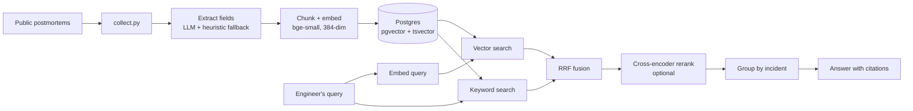

<p align="center"></p>

<p align="center">
  
  
  
  
  
</p>

# OutageLens

During an incident, the most useful question is "has anyone seen this before?" Big
companies publish hundreds of public postmortems, but nobody can read them all at 3 a.m.

**OutageLens** takes a plain-language description of a failure, finds similar past
incidents, and shows how those teams detected and fixed the cause, with links to the
original reports.

> "p99 latency tripled ten minutes after a deploy and the DB connection pool is full"
> returns incidents where a release removed a cache layer, with the root cause, how it
> was detected, and how it was rolled back.

## What makes it more than a chatbot

- **Structured extraction.** Every report is read once at ingestion and turned into
  filterable fields: category, root cause, detection, mitigation, prevention, impact.
- **Hybrid retrieval.** pgvector semantic search plus Postgres full-text, merged with
  Reciprocal Rank Fusion, optionally reordered by a cross-encoder.
- **Measured, not guessed.** `scripts/evaluate.py` and `scripts/eval_by_group.py` compare four retrieval strategies on a labelled query set; `scripts/benchmark.py` load tests the API. See [docs/evaluation.md](docs/evaluation.md).
- **Latency you can see.** Every response includes a per-stage timing breakdown, shown
  as a ribbon in the UI.
- **Works without an LLM.** With `LLM_PROVIDER=none`, answers are assembled from the
  extracted fields. Ollama or Anthropic can be switched on with one env variable.

## Architecture



## Quick start

```bash
cp .env.example .env
make up                      # Postgres + API on http://localhost:8000
make demo                    # loads 6 synthetic incidents to try the UI
```

For real data:

```bash
cp data/sources.example.csv data/sources.csv   # add 100+ postmortem URLs
make collect && make ingest
```

Run the unit tests (no database needed): `pip install -r requirements.txt && make test`

## API

| Method | Path | Purpose |
|---|---|---|
| POST | `/api/search` | Ranked incidents. Options: `mode` (vector, keyword, hybrid), `rerank`, `category`, `company`, `year_from`, `top_k` |
| POST | `/api/ask` | Hybrid search + rerank, then a cited answer |
| GET | `/api/meta` | Categories and companies with counts |
| GET | `/api/stats` | Index size and active models |
| GET | `/health` | Database check |

Interactive docs: `/docs`.

## Design decisions

| Decision | Why | Trade-off |
|---|---|---|
| RRF fusion, not a weighted sum | Scores from the two retrievers are on different scales; ranks are not | Ignores how much better rank 1 is than rank 2 |
| Postgres full-text, not a separate BM25 service | One datastore, simple deploy | `ts_rank_cd` is not BM25 |
| Per-incident results | Engineers want incidents, not fragments | Needs a grouping step after ranking |
| Heuristic fallback for extraction | Ingestion never fails on bad model output | Coarser categories |
| Overlapping 220-word chunks | Keeps boundary sentences retrievable | More rows to embed and store |

More in [docs/architecture.md](docs/architecture.md), including known limitations.

## Results

All numbers below were measured on my own data and laptop with the scripts in this repo. The dataset is small, so the caveats under each table matter.

**Dataset:** 78 public postmortems (collected from a curated list of links), split into 1,051 chunks. 62 evaluation queries with one correct incident each: 6 written by me and 56 drafted with LLM assistance from the incident reports. Incidents were ingested with `--no-llm`, so the extracted fields (category, root cause and so on) come from the simple heuristic fallback rather than an LLM. I did not set aside a separate held-out test set, and I did not tune the system against these queries.

**Retrieval quality** (all 62 queries, top 10 results per query):

| Strategy | Recall@1 | Recall@5 | Recall@10 | MRR |
|---|---|---|---|---|
| vector only | 0.597 | 0.903 | 0.952 | 0.720 |
| keyword only | 0.484 | 0.726 | 0.855 | 0.588 |
| hybrid (RRF) | 0.613 | 0.887 | 0.952 | 0.717 |
| hybrid + rerank | 0.790 | 0.903 | 0.968 | 0.850 |

**Split by who wrote the query** (Recall@1 / MRR):

| Strategy | Hand-written (n=6) | LLM-drafted (n=56) |
|---|---|---|
| vector only | 0.333 / 0.514 | 0.625 / 0.742 |
| keyword only | 0.000 / 0.188 | 0.536 / 0.631 |
| hybrid (RRF) | 0.167 / 0.272 | 0.661 / 0.764 |
| hybrid + rerank | 0.333 / 0.465 | 0.839 / 0.892 |

How to read this:

- Cross-encoder reranking gives the clearest gain: Recall@1 rises from 0.597 to 0.790 and MRR from 0.720 to 0.850 compared with vector-only.
- Hybrid RRF did not beat vector-only on this corpus. Recall@1 differs by one query and MRR is tied.
- The 56 drafted queries were written after reading the same reports that are indexed, so the overall scores are probably optimistic. The 6 hand-written queries score lower, but 6 is too few to draw a conclusion.
- With only 78 incidents, returning 10 results already covers a large share of the corpus, so Recall@10 is easy. Recall@1 and MRR are the more informative columns.

**Latency and throughput** (AMD Ryzen 5 4600H, 7 GB RAM usable, Windows with Docker/WSL2; 60 requests per level; load generator and server on the same machine):

| Strategy | Concurrent users | QPS | p50 ms | p95 ms |
|---|---|---|---|---|
| hybrid | 1 | 10.8 | 88 | 138 |
| hybrid | 8 | 6.5 | 1,091 | 2,107 |
| hybrid + rerank | 1 | 0.2 | 4,985 | 7,495 |
| hybrid + rerank | 8 | 0.2 | 34,041 | 63,583 |

Reranking is roughly 55 times slower than plain hybrid search at the median, and throughput did not improve with 8 concurrent users on this CPU. As measured here, reranking improves ranking quality but is not practical under concurrent load without a GPU, a smaller model, or reranking fewer candidates.

**What failed and what I learned:**

- One query was missed by every strategy: a vague description of build jobs stopping and a queue growing after an infrastructure change. The corpus contains several CI-system incidents (CircleCI, Travis CI, GitHub) with similar symptoms, and only one counts as correct, so this is partly a limitation of single-answer labelling and not only a retrieval error.
- Keyword-only search missed 9 of 62 queries. The ones I looked at describe symptoms in different words than the reports use, for example "destructive storage operation" for a deleted production database. That is the case for semantic search on this kind of data.
- Hybrid fusion did not help here, and it was worse than vector-only on the 6 hand-written queries (Recall@1 0.167 vs 0.333), though with n=6 this could be chance. My guess is that the keyword side adds noise when query words do not appear in the report; I have not tested that.
- I have not yet changed the system because of these results. Next experiments: more hand-written queries, a BM25 comparison, query rewriting for vague symptom descriptions, and reranking fewer candidates to cut latency.

**Reproduce these numbers:**

```bash
docker compose up -d
docker compose exec app python -m scripts.ingest --source data/raw/incidents.jsonl --no-llm
docker compose exec -T app python - < scripts/eval_by_group.py
docker compose exec app python -m scripts.benchmark --queries eval/queries.final2.jsonl --requests 60 --concurrency 1 8
```

The article text in `data/raw/` is not included in this repo (it belongs to the original authors). Rebuild it from `data/sources.csv` with `docker compose exec app python -m scripts.collect`. The queries are in `eval/queries.final2.jsonl`: the first 6 are hand-written and the remaining 56 are LLM-drafted (also split into `queries.valid.jsonl`, `queries.drafts.jsonl` and `queries.drafts2.jsonl`).

## Project layout

```
app/              FastAPI app, retrieval, extraction, LLM adapters, UI
scripts/          collect, ingest, evaluate, benchmark, eval template
tests/            chunking, fusion, metrics, extraction (no DB required)
data/sample/      6 synthetic incidents for smoke tests only
docs/             architecture notes and evaluation method
```

## Roadmap

- [ ] BM25 index for comparison with Postgres full-text
- [ ] Incident timeline extraction (detect, mitigate, resolve durations)
- [ ] Query rewriting for vague symptom descriptions
- [ ] Feedback buttons to collect real relevance judgments

## Data and licensing

The sample data is synthetic. Real postmortems belong to their authors: this project
stores links plus its own extracted fields and short matched passages. Check each
site's terms before collecting.

MIT licensed.
